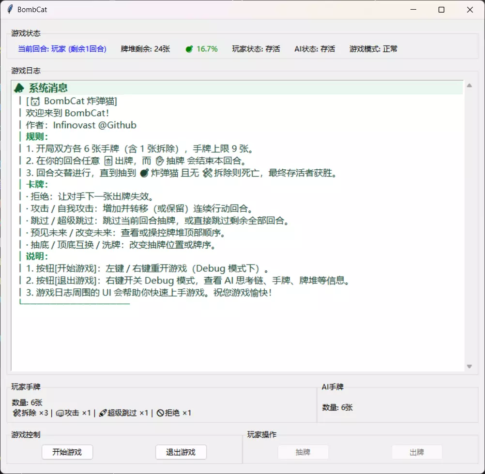
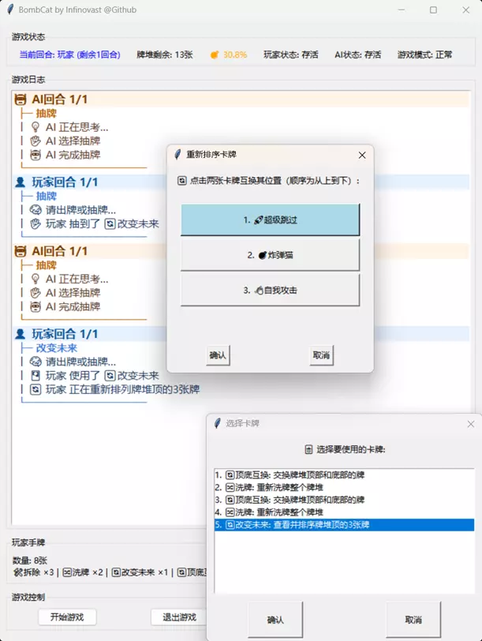

# BombCat

<p align="center">
  
</p>

BombCat 是一个使用 Python 和 Tkinter 的本地单机卡牌游戏。你与 AI 轮流行动，避开炸弹，成为最后存活的一方。

<div align="center">
  <table>
    <tr>
      <td align="center">
        <br>
        图1：主界面
      </td>
      <td align="center">
        <br>
        图2：对局中界面
      </td>
    </tr>
  </table>
</div>

## 运行

需要 Python 3.12+，并附带 Tkinter。项目仅使用 Python 标准库。

```bash
python main.py
```

也可使用 `python dev.py run`；省略 `run` 同样启动游戏。

## Windows 打包

安装 PyInstaller 后，可以打包为单文件 `dist\main.exe`。

```powershell
python -m PyInstaller -w -F -i pic\app.ico --upx-dir="upx可执行程序所在目录" --clean main.py
```

## 操作与规则

- 点击“开始游戏”开局；点击“出牌”选择卡牌，支持双击确认。
- 点击“抽牌”结束当前一次行动。手牌已满时，先出牌再抽牌。
- 双方开局各6张牌，包含一张拆除，手牌上限9张。
- 抽到炸弹猫会自动消耗拆除并选择放回位置；没有拆除则输掉对局。
- 右键“退出游戏”切换 Debug；Debug 下右键“开始游戏”快速重开。

完整牌组和卡牌效果见[规则书](docs/RULEBOOK.md)。

## 本地 AI

AI 使用信息集蒙特卡洛树搜索，根据自己的手牌、公开信息与牌堆记忆采样局面并模拟后续行动。搜索在独立 Python 子进程中运行，重开或退出时取消旧任务。

Debug 中分别显示决策、局面、搜索统计、各候选与牌堆记忆。`?` 表示未知牌；卡牌使用统一简称，炸弹放回位置从牌堆顶部开始、从1计数。

## 开发与测试

```bash
python dev.py test
python dev.py check
python dev.py arena --pairs 4 --iterations 200 --seed 2026
```

也可直接运行测试：

```bash
python -m unittest discover -s tests
```

测试采用模拟 Tk 组件和真实 AI 子进程，不打开桌面窗口。Arena 将搜索策略与启发式策略按相同初始局面交换席位对战。

## 项目结构

- `main.py`、`cards.py`：Tkinter 界面、卡牌显示与操作交互。
- `game_controller.py`：共享核心与界面之间的数据投影、回合展示和私有选择交互。
- `game_core.py`：实际对局和 AI 模拟共同使用的规则、观察与私有记忆。
- `search_ai.py`：启发式策略与信息集搜索。
- `ai_player.py`：界面与 AI 的观察、动作、日志适配。
- `ai_backend.py`、`ai_worker.py`：本地搜索进程、通信与取消。
- `tests/`：规则、搜索、日志及控制器的无窗口测试。

模块边界和搜索方法见[架构说明](docs/ARCHITECTURE.md)。
